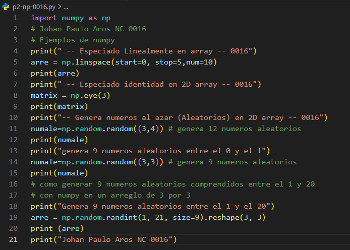
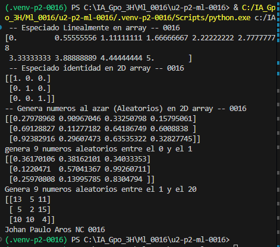

-'start=0:' Valor inicial.

-'stop=1:' Valor final (sin incluirlo necesariamente como límite en todos los casos; en linspace sí se incluye).

-'num=5:' Cantidad de números que se van a generar.

## que es linspace
linspace genera una cantidad específica de números distribuidos uniformemente entre un valor inicial y uno final, incluyendo ambos extremos.

## El codigo 

## Resultado
